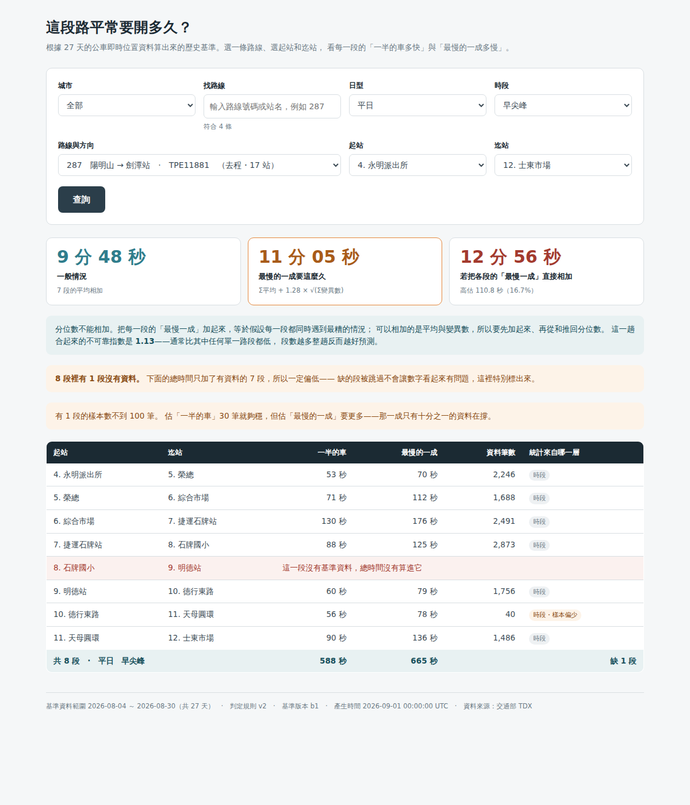

# 公車服務可靠度查詢 API

> 「287 這班車，從永明派出所到士東市場，平日早上尖峰要多久？」
> 打路線號碼 → 選起站 → 選迄站 → 出表格。

台北市與新北市的公車每十秒回報一次位置。上游的資料管線把那些位置點推導成
到站事件，再算出 27 天的歷史基準，最後落在 MySQL。

**這個 repo 是那之上的一層薄殼**：不做任何計算層的事，
只負責把「路線 + 站序區間」翻譯成站牌對、查基準、把多段合成起來。

上游的收集、Kafka、GCS、BigQuery、基準計算在主專案裡，不在這裡。



---

## 快速開始（本機）

需要一個 MySQL 8.x（或 MariaDB 10.11+，要有視窗函數）。

```bash
REPO=git@github.com:你的帳號/bus-reliability-api.git   # ← 不要加角括號，< > 在 shell 裡是重新導向
git clone "$REPO" bus-api && cd bus-api

python -m venv .venv && . .venv/bin/activate
pip install -r requirements-dev.txt

export MYSQL_HOST=127.0.0.1 MYSQL_PORT=3306 \
       MYSQL_USER=root MYSQL_PASSWORD=... MYSQL_DATABASE=bus

python apply_sql.py sql/test_fixture_schema.sql   # 建表
python seed_test.py                               # 假資料
python -m pytest -q                               # 15 passed

uvicorn main:app --reload --port 8000
open http://127.0.0.1:8000/
```

---

## 部署（GCE，跟 MySQL 同一台）

這個 repo clone 進主專案底下，compose 的相對路徑就不用改：

```
~/TKR102/
  ├── api/                       ← clone 到這裡
  │     ├── Dockerfile
  │     └── .env.api             ← 憑證放這裡（本 repo 的 .gitignore 已蓋掉）
  ├── deploy/docker-compose.yml
  └── .env.mysql
```

```bash
cd ~/TKR102
REPO=git@github.com:你的帳號/bus-reliability-api.git   # ← 不要加角括號
git clone "$REPO" api
echo '/api/' >> .gitignore              # 主專案不要去追這個巢狀 repo

# 1. 唯讀帳號 + 憑證，一步完成
#    密碼由腳本產生並直接寫進 .env.api，不經過你的鍵盤，
#    所以資料庫上那組跟檔案裡那組必然一致。
./api/sql/create_readonly_user.sh
git -C api check-ignore -v .env.api     # 要有輸出

# 2. compose 加上 api service（貼 api/api-service.yml 的內容進 services:）
vi deploy/docker-compose.yml

# 3. 起
docker compose -f deploy/docker-compose.yml up -d --build api
docker compose -f deploy/docker-compose.yml logs -f api

# 4. 確認
curl -s localhost:8000/healthz
curl -s 'localhost:8000/api/travel-time?sub_route_uid=TPE11881&direction=0&from_seq=4&to_seq=12' \
  | python3 -m json.tool | head -30
```

從 MacBook 看畫面（Tailscale 已連的話直接開）：`http://100.119.53.70:8000/`

更新只要 `cd ~/TKR102/api && git pull && docker compose -f ../deploy/docker-compose.yml up -d --build api`。

記憶體實測一次：`docker stats --no-stream bus-api`。
`mem_limit: 256m` 是上限不是配額——這台上最該保護的是 Kafka。

---

## 端點

| 方法 | 路徑 | 說明 |
|---|---|---|
| GET | `/api/meta` | 城市／日型／時段的可選值，加上基準的資料範圍與版本 |
| GET | `/api/routes?city=&q=` | 路線方向清單。`q` 比對路線號碼、代碼、站名，完全相同的號碼排最前面 |
| GET | `/api/routes/{uid}/{dir}/stops` | 站序 |
| GET | `/api/travel-time?...` | 主查詢 |
| GET | `/healthz` | 健康檢查 |

主查詢參數：`sub_route_uid`、`direction`、`from_seq`、`to_seq`、
`day_type`（weekday/weekend）、`band`（am_peak/…）。

回傳三塊：

```jsonc
{
  "coverage": { "n_segments": 8, "n_with_data": 7, "n_missing": 1,
                "complete": false, "n_weak_p90": 1 },
  "totals":   { "mean_text": "9 分 48 秒",
                "composed_p90_text": "11 分 05 秒",   // Σmean + 1.28·√Σsd²
                "naive_p90_text": "12 分 56 秒",      // Σp90（錯的算法）
                "overestimate_pct": 16.7,
                "unreliability": 1.13 },
  "segments": [ /* 每一段的明細，含 level 與 p90_reliable */ ]
}
```

互動式文件：跑起來之後開 `/docs`（FastAPI 自動產生）。

---

## 三個刻意的設計，以及不這樣做會怎樣

這三件事的共同點是：**寫錯不會報錯，只會給出一個看起來很正常的錯答案。**
所以每一個都有一支測試守著。

### 1. 相鄰兩站用 `LEAD()`，不是 `seq + 1`

站序有跳號——實際資料裡就有路線缺 `seq 14`。
用 `b.seq = a.seq + 1` 去接，那一段會整個消失：段數少一段、總時間偏低。

```sql
LEAD(seq)        OVER (ORDER BY seq) AS to_seq,
LEAD(station_id) OVER (ORDER BY seq) AS to_station_id
```

→ `test_gap_in_seq_is_not_skipped`

### 2. `LEFT JOIN`，不是 `JOIN`

某個站牌對沒有基準時，那一列要留下來標成「無資料」。
用 `INNER JOIN` 的話缺的段被默默跳過，總時間一樣偏低，一樣沒有徵兆。

所以回傳裡有 `coverage.complete`，畫面上有一塊橘色警告。
**能算出數字**和**數字能用**是兩件事，介面要有辦法講後者。

→ `test_missing_baseline_is_reported_not_dropped`

### 3. 合成用 `Σmean + 1.28·√Σsd²`，不是 `Σp90`

分位數不可加。八段的 p90 直接相加，等於假設八段同時塞車，
那個機率是 0.1 的八次方。可加的是平均與變異數。

畫面上兩個數字並排，右邊那個明講「這是錯的算法，高估了多少」。

副產品：合成後的不可靠指數通常**比其中任何單一路段都低**。
變異數相加但不等比例放大——段數越多，整趟反而越好預測。

→ `test_composition_beats_naive_sum`

### 附帶一個引擎差異

路線清單按號碼的**數值**排序（不然會排成 1, 12, 2, 287, 3）。
第一個排序鍵寫成 `route_name REGEXP '^[0-9]' = 0`，而不是判斷
`REGEXP_SUBSTR` 的結果是不是 `NULL`——因為沒配到時 MySQL 8 回傳 `NULL`、
MariaDB 回傳空字串，而 `CAST('' AS UNSIGNED)` 是 0。
同一句 SQL 在兩個引擎上會排出完全不同的結果。

本機用 MariaDB 開發、正式環境是 MySQL 8.4，這種差異在本機永遠測不出來。
CI 跑的是真的 `mysql:8.4`，所以 `test_route_list_is_ordered_like_a_human_expects`
是在正式環境的引擎上驗的。

---

## 契約測試

schema 的真相在主專案（`TKR102/sql/schema.sql`），這個 repo 只是讀它。
兩個 repo 各自演進，遲早有一邊改了欄位而另一邊不知道。

`test_schema_contract.py` 不比對 DDL 文字，它去問資料庫的
`information_schema`：API 真正會讀的欄位在不在、拿去算術的欄位是不是數值型、
JOIN 兩邊的 `station_id` 型別一不一致（不一致的話 MySQL 會隱式轉型，
JOIN 仍然成立但索引用不上，而且 `'007'` 會等於 `7`）。

**這支測試對著正式資料庫跑也應該全綠**，而且不需要任何假資料：

```bash
MYSQL_HOST=... MYSQL_USER=bus_api ... python -m pytest test_schema_contract.py -q
```

`sql/test_fixture_schema.sql` 是給 CI 用的腳手架，檔名刻意不叫 `schema.sql`——
兩個 repo 裡各有一份同名檔案，遲早會有人在錯的那份上改東西。
它就算過時了也不會騙人，真正的把關在契約測試那邊。

---

## CI

`.github/workflows/tests.yml`：push 就跑，用真的 `mysql:8.4` service container。

換成 SQLite 之類的替身會快很多，但這支服務的三個關鍵行為
（視窗函數、`LEFT JOIN`、`information_schema` 契約）全都是資料庫行為——
用替身測等於沒測到重點。

---

## 安全

- 服務只綁 `127.0.0.1` 與 Tailscale IP，**不綁 `0.0.0.0`**。
  等於「進得了 Tailnet 才看得到」。
- 資料庫用獨立的唯讀帳號 `bus_api`（`sql/create_readonly_user.sh`），
  只有兩張表的 `SELECT`，而且限制從 docker 網段連。
  匯出腳本那個帳號要 `CREATE`/`DROP`/`RENAME`（原子交換用），權限太大，
  不該給唯一會被瀏覽器碰到的服務用。
- 容器不用 root 跑。
- `MYSQL_HOST` 填 docker 服務名 `mysql`，**不是 Tailscale IP**。
  同一個連線字串在網路的不同位置有不同的正確答案，這個專題已經踩過兩次
  （`KAFKA_BOOTSTRAP`、`MONGO_URI`）。容器連容器就走 docker network。

要開給公眾之前，前面得先擺一層反向代理加速率限制，並加上身分驗證。

---

## 已知的限制

- **一個號碼會對到好幾條子路線。** 287 底下有主線、區間車、副線，
  各自又有去返程。清單會全部列出來讓使用者自己挑，靠起訖站名分辨——
  不猜一條給他，猜錯的話他看到的是別條路線的時間，而且不會知道。
- **時段的中文標籤在 `main.py` 的 `BAND_LABEL`，時段的實際定義在主專案的
  `baseline_build.sql`。** 這是兩份真相，改一邊沒改另一邊不會報錯。
  下拉選單的**選項**本身是從資料庫問來的，所以至少不會出現資料庫裡沒有的時段。
- **沒有快取。** 每次查詢都真的打 MySQL。
  以現在的規模（14.5 萬列、整張表常駐記憶體）不需要，
  真的變慢時要先量，不要先猜。
- **`p50` 相加只是參考。** 中位數的和不等於和的中位數。
  介面上主打的是 `mean` 與合成的 `p90`，那兩個才是可加的。

---

## 授權

MIT，見 `LICENSE`。資料來源：交通部 TDX 運輸資料流通服務平臺
（資料本身的使用條款以 TDX 平臺的規定為準）。
